  

  
   

##  Hey, I'm Yashaswini 

AI/ML and Generative AI professional with 4+ years of IT experience, specializing in Python, Machine Learning, and LLM-based applications.

Experienced in building RAG solutions, AI-powered applications, and multi-agent systems using modern GenAI frameworks.

Passionate about developing intelligent, scalable solutions using AI and emerging technologies.

 &nbsp;4+ Years of IT Experience 
 &nbsp;MTech and BTech in Computer Science Engineering 

 

##  Toolbox

  

  
  
  
  
  
  
  
  
  

##  Let's connect

I'm open to AI/ML engineering roles and collaborations. If you're building something with ML, LLMs, RAGs. I'd love to hear about it.

  
  
 

